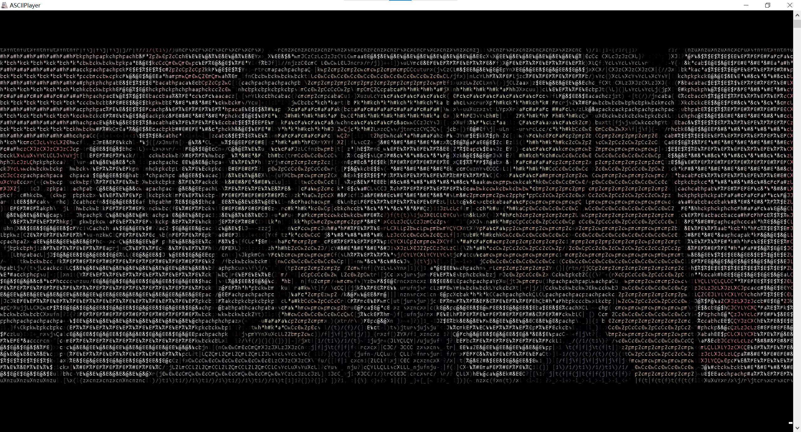

# ASCIIPlayer

<div align="center">



[English](#english) | [中文](#中文)

</div>

---

## English

### What it is

A Windows console program that turns video into colored ASCII animation in the terminal, and can encode that animation into an mp4 / mkv file. ffmpeg is embedded in the exe, so there is nothing else to install.

- 24-bit truecolor by default; `--color256` falls back to the 256-color palette
- frame rate is configurable (1–60) and defaults to the source video's frame rate
- pure-CPU rendering: glyph atlas, 256-entry lookup table and row-parallel composition — no per-character `DrawString`
- the terminal grid follows the window; resizing clears and re-samples instead of squeezing a fixed grid into a different window
- `-r ... --play` also plays audio in the terminal, synchronized to the first displayed frame
- exit codes, `--selftest` and `--no-wait` make it scriptable

Three ways to use it:

```
ASCIIPlayer.exe video.mp4                    play in the current console
ASCIIPlayer.exe video.mp4 -r out.mp4         encode to a video file (keeps source audio)
ASCIIPlayer.exe video.mp4 -r out.mp4 --play  encode and watch in the terminal (with sound)
```

### Requirements

- Windows 10 or newer, with console VT / ANSI support. 24-bit truecolor needs Windows 10 1703 (build 15063) or newer; older systems automatically fall back to 256 colors.
- .NET Framework 4.7.2, x64.
- `cmd` (conhost) or Windows Terminal both work; **Windows Terminal is recommended for maximized playback** (see [Troubleshooting](#maximized-playback-scanline-and-stutter)).
- The exe is about 116 MB because ffmpeg is embedded. On first run it writes `%TEMP%\ffmpeg.exe`, so the temp directory must be writable.
- No separate ffmpeg installation and no NuGet packages.

### Build

Before you build:

1. Get a Windows ffmpeg build (static, GPL or LGPL), take `ffmpeg.exe`.
2. Put it at `Resources\ffmpeg.exe` in the project.
3. Set its build action to **Embedded Resource**.
4. The resource name must resolve to `ASCIIPlayer.Resources.ffmpeg.exe`. If your root namespace or folder differs, either rename the resource or edit the string in `Program.cs` — pick one.

Then build the solution:

```powershell
& "C:\Program Files\Microsoft Visual Studio\2022\Community\MSBuild\Current\Bin\MSBuild.exe" `
    ASCIIPlayer.sln /t:Rebuild /p:Configuration=Release /p:Platform="Any CPU"
```

Output is `ASCIIPlayer\bin\Release\ASCIIPlayer.exe` (~116 MB), plus `.config` and `.pdb`. Debug builds go to `bin\Debug\`; Release has compiler optimizations enabled and is noticeably faster.

At runtime the embedded exe is extracted to `%TEMP%\ffmpeg.exe` and reused if it is already there.

### Usage

```
ASCIIPlayer.exe <video> [options]

  -r, --render <path>   encode the ASCII animation to a video (mp4 / mkv)
  -n, --size <WxH>      output resolution, 320x240–7680x4320
                        defaults to a grid derived from the current console window
  -f, --fps <rate>      1–60, defaults to the source frame rate (24 if unknown)
  --play                (with -r) play in the terminal while encoding, with audio
  --color256            use the 256-color palette in the terminal
  --truecolor           force 24-bit truecolor (automatic on Windows 10 1703+)
  --mute                no sound; also skips audio extraction
  -v, --verbose         diagnostics to stderr (ffmpeg path, fps, color mode, grid, audio, throughput, skipped frames)
  --no-wait             don't wait for a key press at the end (scripts / CI)
  -h, --help            show help
  --selftest            41 internal checks, no video and no ffmpeg required
```

Exit codes:

| Code | Meaning |
|---|---|
| 0 | success (including `-h` and a passing `--selftest`) |
| 1 | runtime failure: encode error, non-zero ffmpeg exit, no frames received, empty output, output directory missing |
| 2 | bad arguments or missing input: unknown option, missing option value, `-n` / `-f` out of range, video not found, no arguments |

Notes:

- The first non-option argument is the video path; relative paths work.
- `-n` only matters with `-r`; it is ignored for plain playback.
- `--color256` / `--truecolor` only affect the terminal. The encoded video always uses the real per-cell RGB values.
- Plain playback pauses on "press any key" only when a console is attached and stdin/stdout are not redirected; `--no-wait` forces it off. There are no pause/seek hotkeys — `Ctrl+C` aborts (a file being encoded may be incomplete).
- `-n` is rounded down to whole character cells (8x16), so the actual output can be slightly smaller: `-n 1919x1079` becomes `1912x1072`. Without `-n`, the grid comes from the console at startup, or 80x25 when there is no console.

Examples:

```bat
ASCIIPlayer.exe video.mp4
ASCIIPlayer.exe video.mp4 -f 30
ASCIIPlayer.exe video.mp4 -r out.mp4
ASCIIPlayer.exe video.mp4 -r out.mp4 -n 1920x1080 -f 30
ASCIIPlayer.exe video.mp4 -r out.mkv -n 2560x1440
ASCIIPlayer.exe video.mp4 -r out.mp4 --play
ASCIIPlayer.exe --selftest
```

### How it works

#### Sampling and characters

1. ffmpeg decodes the source into a fixed `640x360` rgb24 stream: `fps=N, scale=640:360:force_original_aspect_ratio=decrease, pad=640:360:...` (black bars keep the aspect ratio).
2. Each character cell averages 1–4 vertical sample rows (chosen from the console font's cell aspect ratio; encoding uses 2) and the center column.
3. Luma is `(r*30 + g*59 + b*11) / 100`, then an 8x8 Bayer dither (strength 0.5) and a gamma 0.85 curve feed a 256-entry lookup table that picks one of 70 ramp characters (space up to `@` / `$`).
4. Spaces stay blank; every other cell is drawn in that cell's average color. There is one foreground color per cell and no background color.

#### Terminal display

- The cell aspect ratio is measured from the console font (`GetCurrentConsoleFontEx`, falling back to client-area pixels divided by rows/columns), so switching to a font like 8x12 or 10x20 does not distort the image.
- The visible area is re-read every frame. If the grid changed, the screen is cleared and re-sampled; the **encoding** grid stays fixed at the resolution chosen at startup.
- Line wrapping is disabled during playback (`ENABLE_WRAP_AT_EOL_OUTPUT` cleared) and restored on exit, so a one-cell width mismatch cannot push the frame down a line.
- Each row erases to end of line (`ESC[K`), so a wider previous frame does not leave artifacts.
- Colors: `ESC[38;2;r;g;b` by default; `--color256` maps the 6x6x6 cube to `ESC[38;5;n`. Runs of identical color share a single escape.
- Minimum grid is 10x3; below that, drawing pauses (encoding continues). Rows use `visible height - 1` to avoid scrolling.
- Output is UTF-8 (BOM-free when redirected), so Chinese diagnostics survive pipes and CI logs.

#### Encoding

- Frames are composed directly into a 24bpp BGR buffer and piped to ffmpeg over stdin: `-f rawvideo -pix_fmt bgr24 -s WxH -r fps -i -`, with the source video as a second input for audio: `-map 0:v:0 -map 1:a:0?`, `libx264 -preset medium -crf 20 -pix_fmt yuv420p`, `aac 192k`, `-shortest`.
- ffmpeg's exit code and the output file are checked; on failure the tail of ffmpeg's stderr is printed.
- The encoding grid is fixed (`-n` or the startup window) and is independent of the terminal grid.
- Encode-only mode prints progress every 30 frames; while playing, progress is suppressed so it cannot corrupt the animation.

#### Audio and timing

- Whenever the terminal will play (plain playback or `-r --play`), the whole audio track is extracted to a temporary WAV (`-vn -ac 2 -ar 44100`) and played with `SoundPlayer`; it is deleted on exit.
- Playback timing and audio both start at the moment the **first frame is displayed**, so ffmpeg startup and audio extraction do not cause A/V drift.
- `-r` without `--play` is silent in the terminal, but the output file still contains the source audio.
- Default fps comes from the first `N fps` in ffmpeg's metadata, clamped to 1–60 (24 if unknown). Playback advances by exactly `1000/fps` ms. When the terminal cannot keep up, drawing is skipped (`-v` reports it) while encoding never drops frames.

### Performance

The render path no longer does "one `DrawString` per character plus a `LockBits` copy per frame":

1. On startup the 70 characters are rasterized once into 8x16 glyph masks; each mask stores the x positions of lit pixels per row.
2. Luma maps to a character index through a 256-entry table instead of one `Math.Pow` per cell.
3. Composition writes straight into the BGR byte buffer; rows never overlap, so rows are composed in parallel (`Parallel.For` from 2048 cells up).
4. Release builds enable compiler optimizations (`<Optimize>true</Optimize>`).

Measured on one machine (3 s / 90 frames, `-f 30`, includes x264 encoding; scales with CPU):

| Output | Grid | Throughput | Per frame |
|---|---|---|---|
| 1280x720 | 160x45 | 125 fps | 8.0 ms |
| 1920x1080 | 240x67 | 78 fps | 12.8 ms |
| 2560x1440 | 320x90 | 48 fps | 20.8 ms |

For comparison, the old renderer alone (no encoding) took 22 / 50 / 90 ms per frame.

Note that this throughput is "compose + encode"; painting a full screen in the terminal is a separate bottleneck owned by conhost (see [Troubleshooting](#maximized-playback-scanline-and-stutter)).

### Testing

```bat
python testtools\regress.py            :: build Release + run all 30 tests
python testtools\regress.py --no-build :: use the existing exe
python testtools\regress.py -k resize  :: only tests whose name matches
python testtools\regress.py --verbose  :: print commands and child output
ASCIIPlayer.exe --selftest             :: 41 internal checks (no ffmpeg / console)
```

The regression suite covers command-line exit codes, frame rate (default / explicit / upper bound), resolution, audio and no-audio sources, duration, truecolor and 256-color escapes, line width never exceeding the window, live resize (100x30 → 60x20 → 120x40) with a fixed encode resolution, audio loading for `-r --play`, bad input, and 720p/1440p throughput floors. Test media is generated into `testtools\.work\`; details are in [`testtools/README.md`](testtools/README.md).

### Troubleshooting

#### Maximized playback: scanline and stutter

This is how **conhost presents output**, not a frame pacing bug:

1. Each frame writes a full screen of characters plus color escapes. In truecolor almost every cell has a different color, so every cell writes `ESC[38;2;r;g;b`. That is roughly **250 KB per frame** at 240x70, about 7.5 MB/s at 30 fps; a 2560x1440 screen is ~400 KB per frame and 4K is ~1 MB per frame.
2. conhost parses escapes in chunks and repaints asynchronously: it starts drawing the top of the screen before parsing has finished, which looks like a top-to-bottom scan. The VT path has no "present this frame atomically" command (DEC 2026 synchronized output is not supported by conhost), and truecolor turns almost every cell into an independent draw run, multiplying GDI glyph work.

What helps, in order of value:

- **Switch to Windows Terminal** (Settings → Startup → Default terminal, or `wt cmd`): GPU rendering, the scan mostly disappears.
- Lower the frame rate while maximized: `-f 10` or `-f 15`.
- Use `--color256` while maximized: escapes are about half as long and color runs merge more often.
- Use a smaller font or window height; fewer cells helps immediately.

What cannot be done: with "cmd/conhost + VT escapes + truecolor + fullscreen" the scan cannot be removed completely. Fixing it for real means changing the presentation path: Windows Terminal (recommended), or replacing the output layer with `WriteConsoleOutputW` (16 colors) or a custom renderer (no longer a terminal program).

#### No sound

- Sound is only produced when playing in the terminal: plain playback or `-r ... --play`. `-r` alone is silent in the terminal but still writes audio into the output file.
- `--mute` skips audio extraction, so there is no sound.
- `-v` prints `[asciiplayer] 音频: 已加载` or `音频: 源视频没有音轨，或提取失败`.
- The whole track is extracted to WAV; for long videos, playback waits for extraction first.

#### The window flashes when resizing

By design: a size change clears the screen and re-samples the new grid, so old content cannot leave artifacts. The encoded resolution is unaffected (fixed at startup or by `-n`).

#### Output video colors look washed out compared to the terminal

The output is `yuv420p` (required for broad H.264 compatibility), and chroma subsampling desaturates thin strokes. Terminal output is truecolor and unaffected. For more color fidelity you could switch ffmpeg to `yuv444p`, at the cost of compatibility and size (no switch for this yet).

#### Raw `ESC[...` or garbled output in the terminal

The console does not support VT / ANSI (old Windows, some third-party terminals, or output redirected into something that does not interpret ANSI). On Windows 10+, use Windows Terminal or the official conhost; try `--color256`. When redirected to a file, escapes are expected — the file simply contains ANSI text.

#### Output directory missing / empty output file

The program does not create directories; `-r D:\no\such\out.mp4` exits with code 1 and an error. Create the directory first. On failure, the error message or `-v` includes the tail of ffmpeg's stderr.

#### ffmpeg extraction failed

On first run the embedded ffmpeg is written to `%TEMP%\ffmpeg.exe`. Failures are usually an unwritable temp directory, a full disk, or antivirus interference; you can also copy `Resources\ffmpeg.exe` to `%TEMP%\ffmpeg.exe` manually and retry.

#### MSBuild not found

`msbuild` is usually not on `PATH`; use the full path shown under Build, or run from a "Developer PowerShell for VS 2022".

### External dependencies

No NuGet packages. The only bundled dependency is ffmpeg.

**ffmpeg.exe**

- Purpose: decode video, produce raw RGB frames, extract audio, encode the output video.
- Distribution: embedded as a resource, extracted to `%TEMP%` at runtime.
- Source: any Windows static build (Gyan.dev, BtbN, etc.).
- License: ffmpeg is not part of this project. Its license is GPL or LGPL depending on the build you choose. Check and comply with the one you use. If you distribute this program with a GPL build, the whole program must be distributed under the GPL as well.

---

## 中文

### 这是什么

一个 Windows 控制台程序：把视频变成终端里的彩色 ASCII 动画，也能把动画编码成 mp4 / mkv 文件。ffmpeg 内嵌在 exe 里，不需要另外安装。

- 终端默认 24-bit 真彩色，`--color256` 可退回 256 色
- 帧率可指定（1–60），默认跟随源视频
- 纯 CPU 渲染：字符点阵 + 256 项查找表 + 按行并行合成，不再逐字符调 `DrawString`
- 终端网格跟着窗口走：改窗口大小自动清屏重采样，不会把固定网格硬塞进新窗口
- `-r ... --play` 时终端里也有声音，音画从首帧对齐
- 有退出码、`--selftest`、`--no-wait`，方便脚本调用

三种用法：

```
ASCIIPlayer.exe video.mp4                    终端播放
ASCIIPlayer.exe video.mp4 -r out.mp4         编码输出（带原视频音轨）
ASCIIPlayer.exe video.mp4 -r out.mp4 --play  边编码边在终端播放（带声音）
```

### 环境要求

- Windows 10 及以上，需要控制台的 VT / ANSI 支持。24-bit 真彩色需要 Windows 10 1703（build 15063）及以上，更老的系统会自动退回 256 色。
- .NET Framework 4.7.2，x64。
- `cmd`（conhost）和 Windows Terminal 都能用；**全屏/最大化播放推荐 Windows Terminal**（原因见[常见问题](#最大化播放时扫描与卡顿)）。
- exe 约 116 MB（内嵌 ffmpeg）。首次运行会把 ffmpeg 写到 `%TEMP%\ffmpeg.exe`，所以临时目录需要可写。
- 不需要单独安装 ffmpeg，也没有 NuGet 依赖。

### 编译

编译前要做的事：

1. 下载一个 Windows 版 ffmpeg（静态构建，GPL 或 LGPL 都行），取出 `ffmpeg.exe`。
2. 放到项目的 `Resources\ffmpeg.exe`。
3. 生成操作设为 **嵌入的资源**（Embedded Resource）。
4. 资源名要能解析成 `ASCIIPlayer.Resources.ffmpeg.exe`。根命名空间或文件夹名不一样的话，要么改资源名，要么改 `Program.cs` 里的字符串，二选一。

然后编译解决方案：

```powershell
& "C:\Program Files\Microsoft Visual Studio\2022\Community\MSBuild\Current\Bin\MSBuild.exe" `
    ASCIIPlayer.sln /t:Rebuild /p:Configuration=Release /p:Platform="Any CPU"
```

产物是 `ASCIIPlayer\bin\Release\ASCIIPlayer.exe`（约 116 MB），以及 `.config` 和 `.pdb`。Debug 输出到 `bin\Debug\`；Release 打开了编译优化，性能差别明显。

运行时内嵌的 exe 会释放到 `%TEMP%\ffmpeg.exe`，已经存在就直接复用。

### 用法

```
ASCIIPlayer.exe <视频文件> [选项]

  -r, --render <路径>   把 ASCII 动画编码成视频（mp4 / mkv）
  -n, --size <WxH>      输出分辨率，320x240–7680x4320
                        不指定就按当前控制台窗口反推字符网格
  -f, --fps <帧率>      1–60，默认取源视频帧率（读不到时 24）
  --play                配合 -r：编码的同时在终端播放，并播放声音
  --color256            终端用 256 色
  --truecolor           强制 24-bit 真彩色（Windows 10 1703+ 默认启用）
  --mute                不播放声音，也跳过音频提取
  -v, --verbose         诊断信息打到 stderr（ffmpeg 路径、帧率、颜色模式、网格、音频、吞吐、跳帧数）
  --no-wait             结束后不等待按键（脚本 / CI 用）
  -h, --help            显示帮助
  --selftest            41 项内部自检，不读视频也不启动 ffmpeg
```

退出码：

| 码 | 含义 |
|---|---|
| 0 | 成功（`-h`、`--selftest` 通过也算） |
| 1 | 运行失败：编码失败、ffmpeg 退出码非 0、没收到帧、输出文件为空、输出目录不存在 |
| 2 | 参数问题或输入不存在：未知参数、缺选项值、`-n` / `-f` 越界、视频文件不存在、没有参数 |

说明：

- 第一个非选项参数是视频路径，相对路径可用。
- `-n` 只在同时给了 `-r` 时有用，纯播放时忽略。
- `--color256` / `--truecolor` 只影响终端；输出视频始终用每格的真实 RGB 合成。
- 纯播放时，只有存在控制台且 stdin/stdout 没被重定向才会停在“按任意键退出”；`--no-wait` 可强制跳过。播放期间没有暂停/快进快捷键，`Ctrl+C` 中止（正在编码的文件可能不完整）。
- `-n` 会向下取整到字符格的整数倍（8x16），实际输出可能略小：`-n 1919x1079` 实际是 `1912x1072`。不指定 `-n` 时按启动时的窗口定网格，没有控制台（管道）时回退到 80x25。

示例：

```bat
ASCIIPlayer.exe video.mp4
ASCIIPlayer.exe video.mp4 -f 30
ASCIIPlayer.exe video.mp4 -r out.mp4
ASCIIPlayer.exe video.mp4 -r out.mp4 -n 1920x1080 -f 30
ASCIIPlayer.exe video.mp4 -r out.mkv -n 2560x1440
ASCIIPlayer.exe video.mp4 -r out.mp4 --play
ASCIIPlayer.exe --selftest
```

### 工作原理

#### 采样与字符

1. ffmpeg 先把源视频解码成固定的 `640x360` rgb24 流：`fps=N, scale=640:360:force_original_aspect_ratio=decrease, pad=640:360:...`（补黑边保持比例）。
2. 每个字符格在垂直方向取 1–4 行、水平取格中心列做平均，作为该格颜色（行数按控制台字体高宽比决定；编码固定取 2 行）。
3. 亮度用 `(r*30 + g*59 + b*11) / 100`，加 8x8 Bayer 抖动（强度 0.5）后过 gamma 0.85 曲线，查 256 项查找表，从 70 级字符表（空格到 `@` / `$`）里选一个字符。
4. 空格不发光；其余字符用该格的平均色作为前景色。每个格子只有一种前景色，没有背景色。

#### 终端显示

- 字符格高宽比从控制台字体测量（`GetCurrentConsoleFontEx`，退化到客户区像素除以行列数），所以换成 8x12、10x20 之类字体画面比例不会变形。
- 每帧重新读取可见区域。网格变了就清屏并按新网格重采样；**编码**用的网格保持启动时确定的分辨率不变。
- 播放期间关掉自动换行（清掉 `ENABLE_WRAP_AT_EOL_OUTPUT`），退出时恢复，即使宽度差一格也不会把整帧往下推。
- 每行擦除到行尾（`ESC[K`），窗口变宽/变窄不残留上一帧的字符。
- 颜色：默认 `ESC[38;2;r;g;b`；`--color256` 用 6x6x6 色立方映射成 `ESC[38;5;n`。连续同色只发一次转义。
- 网格下限 10x3，窗口更小时暂停绘制（编码继续）。行数取“可见高度 - 1”，留一行防滚屏。
- 输出统一 UTF-8（重定向时无 BOM），中文诊断在管道和 CI 日志里不会乱码。

#### 编码输出

- 每帧直接合成到 24bpp BGR 字节缓冲，通过 stdin 喂给 ffmpeg：`-f rawvideo -pix_fmt bgr24 -s WxH -r fps -i -`，同时把源视频作为第二个输入读音轨：`-map 0:v:0 -map 1:a:0?`，`libx264 -preset medium -crf 20 -pix_fmt yuv420p`，`aac 192k`，`-shortest`。
- 会检查 ffmpeg 退出码和输出文件；失败时打印 ffmpeg stderr 的尾部。
- 编码网格固定（`-n` 或启动时的窗口），与终端显示网格互相独立。
- 纯编码时每 30 帧刷新一次进度；边编码边播放时不打印进度，避免打乱画面。

#### 声音与节奏

- 只要会在终端里播放（纯播放或 `-r --play`），就把音轨整段提取成临时 WAV（`-vn -ac 2 -ar 44100`），用 `SoundPlayer` 播放，退出时删除。
- 播放计时和音频都在**第一帧显示的那一刻**开始，ffmpeg 启动和音频提取的耗时不会造成音画错位。
- `-r` 不加 `--play` 时终端不出声，但输出文件里仍然有源音轨。
- 默认帧率取自 ffmpeg 元数据里第一个 `N fps`，夹到 1–60（读不到用 24）。播放按精确的 `1000/fps` 毫秒推进；终端跟不上时跳过绘制（`-v` 会报告），但编码不跳帧。

### 性能

渲染路径换掉了“每个字符一次 `DrawString` + 每帧 `LockBits` 拷贝”的做法：

1. 启动时把 70 个字符栅格化成 8x16 点阵，记录每行亮像素的 x 坐标。
2. 亮度 → 字符下标用 256 项查找表，不再每格一次 `Math.Pow`。
3. 合成直接写 BGR 字节缓冲；行与行互不重叠，所以按行 `Parallel.For`（≥2048 格时启用）。
4. Release 配置启用编译优化（`<Optimize>true</Optimize>`）。

本机实测（3 秒 / 90 帧，`-f 30`，含 x264 编码，随 CPU 变化）：

| 输出分辨率 | 字符网格 | 吞吐 | 每帧耗时 |
|---|---|---|---|
| 1280x720 | 160x45 | 125 帧/秒 | 8.0 ms |
| 1920x1080 | 240x67 | 78 帧/秒 | 12.8 ms |
| 2560x1440 | 320x90 | 48 帧/秒 | 20.8 ms |

对比：旧实现**只算渲染**（不含编码）每帧就要 22 / 50 / 90 ms。

注意这里的吞吐是“算 + 编码”；把整屏画进终端是另一回事，瓶颈在 conhost 的呈现
（见[常见问题](#最大化播放时扫描与卡顿)）。

### 测试

```bat
python testtools\regress.py            :: 编译 Release + 跑全部 30 项
python testtools\regress.py --no-build :: 用现有 exe
python testtools\regress.py -k resize  :: 只跑名字匹配的
python testtools\regress.py --verbose  :: 打印命令行和子进程输出
ASCIIPlayer.exe --selftest             :: 41 项内部自检（不依赖 ffmpeg / 控制台）
```

回归测试覆盖命令行退出码、帧率（默认/指定/上限）、分辨率、有无音轨、时长、
真彩色/256 色转义、行宽不超过窗口、播放中改窗口（100x30 → 60x20 → 120x40）时
网格跟随且编码分辨率不变、`-r --play` 的音频加载、坏输入报错，以及 720p/1440p 的吞吐下限。
测试素材生成在 `testtools\.work\`，细节见 [`testtools/README.md`](testtools/README.md)。

### 常见问题

#### 最大化播放时扫描与卡顿

这是 **conhost 的呈现机制**，不是播放器算错了帧：

1. 每帧要写一整屏字符 + 颜色转义。真彩色下相邻格颜色几乎都不同，等于每格一次 `ESC[38;2;r;g;b`。240x70 约 **250 KB/帧**，30 fps 约 7.5 MB/s；2560x1440 满屏约 400 KB/帧，4K 满屏约 1 MB/帧。
2. conhost 按块解析转义并异步重绘：解析还没结束，渲染线程已经开画顶部区域，于是看到“从上往下扫”。VT 路径没有“整帧画完再显示”的指令（DEC 2026 同步输出 conhost 目前不支持），真彩色还让几乎每个格子成为独立的绘制 run，GDI 字形开销成倍增加。

可以做的（按性价比）：

- **换成 Windows Terminal**（设置 → 启动 → 默认终端，或 `wt cmd`）：GPU 渲染，扫描感基本消失。
- 最大化时降帧：`-f 10` 或 `-f 15`。
- 最大化时用 `--color256`：转义短一半，颜色 run 更容易合并。
- 用低一点的窗口高度 / 字号，格数下降，效果直接。

**不能做的**：在“cmd/conhost + VT 转义 + 真彩色 + 全屏”这个组合下，无法彻底消除扫描感。要根治只能换呈现通道：Windows Terminal（推荐），或把输出层改成 `WriteConsoleOutputW` 整块提交（16 色）/ 自绘窗口（不再是终端程序）。

#### 没有声音

- 只有“在终端里播放”时才会出声：纯播放，或 `-r ... --play`。`-r` 单独用时不播放声音，但输出文件里有音轨。
- `--mute` 会跳过音频提取，自然没有声音。
- `-v` 会打印 `[asciiplayer] 音频: 已加载` 或 `音频: 源视频没有音轨，或提取失败`。
- 音频整段提取成 WAV，源视频很长时开始播放前要先等提取完成。

#### 改窗口大小时会闪一下

设计如此：尺寸变化后清屏并按新网格重采样，避免旧内容错位残留。编码输出分辨率不受影响（固定为启动时的网格，或 `-n` 指定的分辨率）。

#### 输出视频的颜色比终端里淡

输出是 `yuv420p`（h264 兼容性要求），色度抽样会把细笔画的颜色冲淡；终端输出是真彩色，不受影响。需要更保色可以把 ffmpeg 输出改成 `yuv444p`，但兼容性和体积会变差（当前版本未提供开关）。

#### 终端里出现 `ESC[...` 原文，或一片乱码

当前控制台不支持 VT / ANSI（老系统、某些第三方终端，或把输出重定向到不支持 ANSI 的文件）。Windows 10 以上建议用 Windows Terminal 或官方 conhost；也可以先 `--color256` 试。重定向到文件时看到转义是正常的，文件里就是 ANSI 文本。

#### 输出目录不存在 / 输出文件为空

程序不会自动建目录（`-r D:\no\such\out.mp4` 会以退出码 1 失败并提示）。先建好目录。输出为空或 ffmpeg 非 0 退出时，`-v` 或错误信息里会带 ffmpeg stderr 尾部。

#### ffmpeg 提取失败

首次运行会把内嵌 ffmpeg 写到 `%TEMP%\ffmpeg.exe`。失败通常是临时目录不可写、磁盘满或安全软件拦截；也可以手动把 `Resources\ffmpeg.exe` 复制到 `%TEMP%\ffmpeg.exe` 后重试。

#### 编译时报找不到 MSBuild

`msbuild` 通常不在 `PATH`，用「编译」一节的完整路径，或从“Developer PowerShell for VS 2022”里执行。

### 外部依赖

没有引入任何 NuGet 包，唯一的内置依赖是 ffmpeg。

**ffmpeg.exe**

- 用途：解码视频、输出原始 RGB 帧、提取音频、编码输出视频。
- 分发：作为嵌入资源打包进程序，运行时释放到 `%TEMP%`。
- 来源：任选一个 Windows 静态构建（Gyan.dev、BtbN 等）。
- 许可：ffmpeg 不是本项目的一部分，其许可是 GPL 或 LGPL，取决于你选用的构建。请自行确认并遵守对应许可。若你以 GPL 构建分发本程序，整个程序也需要按 GPL 分发。